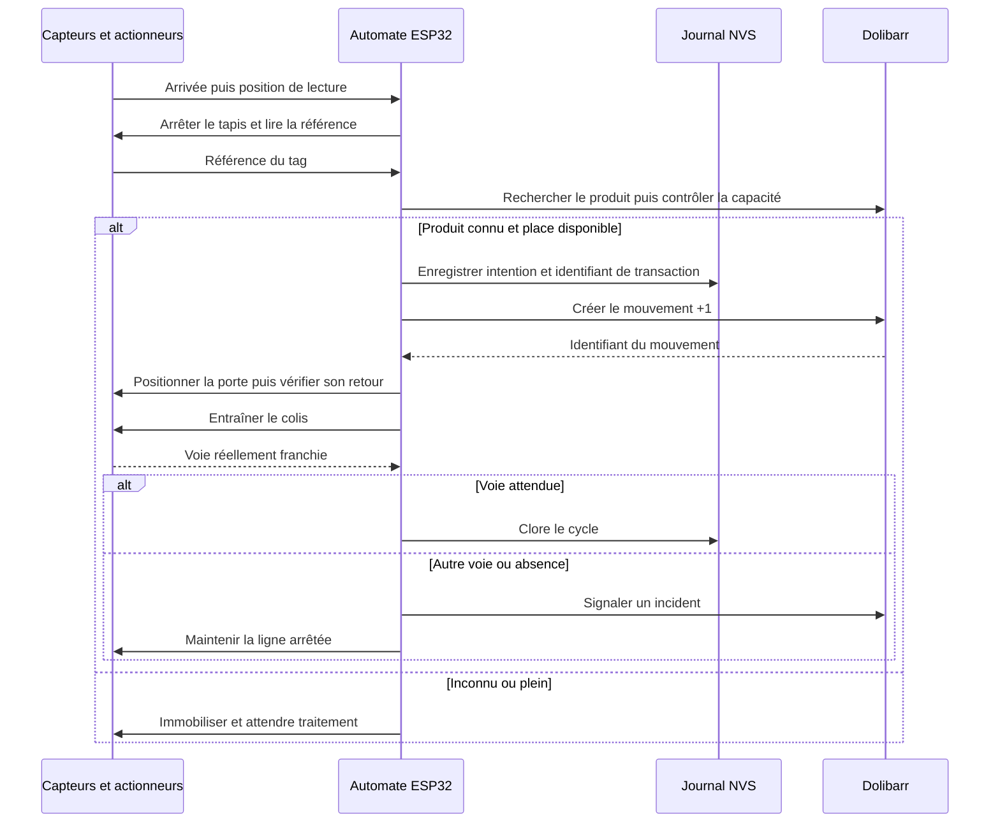

# Feuille de route POC et procès-verbal de recette

## Faire valider le montage avant la séance

Le contrôleur présumé est un M5Stack Core ESP32 avec carte SD. Relever la référence de la carte porteuse, la révision du silicium, la capacité flash, les broches réservées par l’écran et la SD, le driver du tapis, les fins de course, le servo et le protocole du lecteur. L’adaptateur proposé attend un driver PWM externe, un détecteur d’arrivée, un détecteur de présence au lecteur, trois retours de position de porte et un lecteur ou pont NFC UART qui émet la référence ASCII suivie de LF. Une étiquette contenant seulement un UID ne suffit pas. Photographier et faire approuver le schéma avant de renseigner le profil. Si les GPIO disponibles sont insuffisants, prévoir un module d’E/S et adapter le pilote.

**Fermeture de boucle proposée.** Installer une barrière photoélectrique traversante après chaque bifurcation, à un endroit où un colis engagé ne peut plus changer de voie. Chaque paire émetteur/récepteur couvre la largeur utile. La sortie observée est celle du faisceau coupé. Une coupure sur une autre voie déclenche un incident, plusieurs voies simultanées donnent le code observé −1, aucune avant l’échéance donne 0. Vérifier que les trois faisceaux sont libres avant libération. La traversée mesure la destination réelle du colis indépendamment de la commande du servo.

| Poste | Hypothèse budgétaire POC, hors devis |
|---|---:|
| 3 barrières traversantes de banc, 10–20 € la paire | 30–60 € |
| Supports réglables, câble et connectique | 15–30 € |
| Interface d’entrée compatible 3,3 V | 10–25 € |
| Total estimatif pour la détection en sortie | **55–115 €** |

Le budget exclut montage industriel, protections, pont NFC, retours de porte et éventuelle extension d’E/S. Valider les niveaux et la polarité avec l’électricien. Prévoir un état moteur désactivé au reset et un arrêt matériel indépendant du logiciel. Poussière, lumière parasite, emballages transparents et vibrations imposent des essais. Le pilote échantillonne toutes les 20 ms environ. Mesurer la plus courte occultation à vitesse maximale et la latence maximale réelle. Si elle peut passer entre deux lectures, ajouter une entrée mémorisée ou un pilote par interruption avant recette. Admission limitée à un colis à la fois, avec interverrouillage amont à vérifier. Pas de compensation automatique de stock en cas de mauvaise voie.

**Visa encadrant à obtenir** — nom, date, références des capteurs, budget approuvé, réserves et signature : ____________________.

## Séquence nominale et écarts

## Tâches et synchronisation

| Tâche applicative | Priorité / pile ESP-IDF en octets | Échanges et responsabilité |
|---|---|---|
| fsm | 4 / 6 144 | Propriétaire des actionneurs et du journal. Polling borné par attente de notification de 20 ms. Envoie une requête et reçoit son résultat sur deux files FreeRTOS de profondeur 1. Surveille le délai par horloge monotone. |
| wms | 3 / 16 384 | Attend sur la file des requêtes, effectue l’appel HTTPS à durée limitée, répond avec le numéro de cycle. La pile inclut une réponse HTTP bornée à 4 Kio. |
| Serveur HTTP ESP-IDF | Paramètres de HTTPD_DEFAULT_CONFIG | Lit une copie courte des métriques sous verrou portMUX. Aucun accès aux actionneurs. |
| Services ESP-IDF | Valeurs de la version du SDK | Wi-Fi, TCP/IP, boucle événementielle et minuterie. La reconnexion Wi-Fi passe par les événements de station. |

Aucune temporisation de déplacement ne valide un tri. Les attentes de file ou notification libèrent le processeur. Le journal flash et les appels d’E/S ont néanmoins une latence à mesurer. Le watchdog surveille la tâche de contrôle, l’échéance de l’automate couvre le worker WMS. **Piles non mesurées.** Les champs fsm_stack_free_min et wms_stack_free_min de /health exposent les minima des deux tâches applicatives via uxTaskGetStackHighWaterMark. Exécuter TLS avec réponse maximale, puis les branches d’erreur et /health simultanément. Archiver le minimum en octets par tâche et la version SDK. Critère POC proposé : conserver au moins 25 % de la pile dans le pire cas mesuré. Ajuster et répéter le test si nécessaire.

## Sessions client

| Durée | Déroulé | Preuve attendue |
|---|---|---|
| 30 min optionnelles, matériel | 0–10 identifier et mesurer ; 10–20 commander le tapis et mesurer les 3 positions ; 20–30 tester les barrières et un tag | Profil de brochage signé, valeurs PWM, trame brute, durée minimale d’occultation |
| 30 min optionnelles, WMS | 0–10 préparer trois produits et entrepôts de test ; 10–20 nominal et plein ; 20–30 inconnu, droits refusés et incident | Requêtes expurgées du token, codes HTTP, ID du mouvement et de l’incident |
| 45 min obligatoires, firmware | 0–5 prévol ; 5–14 trois voies ; 14–21 erreur de voie et bourrage ; 21–29 coupure réseau et coupure après POST ; 29–37 mise à jour signée et essai corrompu ; 37–45 watchdog, /health et collecte | Relevé horodaté, stock avant/après, raison de reset, identité des deux images, visa |

Pour chaque essai noter opérateur, version, lot, référence, attente, résultat observé et anomalie. Rejouer au minimum un colis par voie et dix cycles par voie pour la répétabilité. Injecter 401, 404, 409, 500, JSON invalide et réponse perdue après POST. Un colis refusé doit produire zéro mouvement. Un colis abouti doit produire exactement +1 et la bonne voie. Après perte du retour POST, rechercher le mouvement par son identifiant de transaction avant toute régularisation. Tester une configuration altérée, une image signée avec une autre clé, une coupure pendant écriture et un blocage de la tâche de contrôle. Tant que des créneaux ou preuves manquent, garder les cases correspondantes ouvertes.
